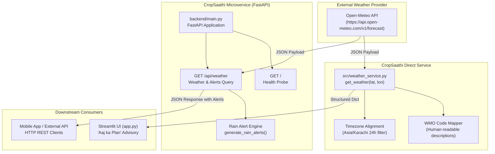
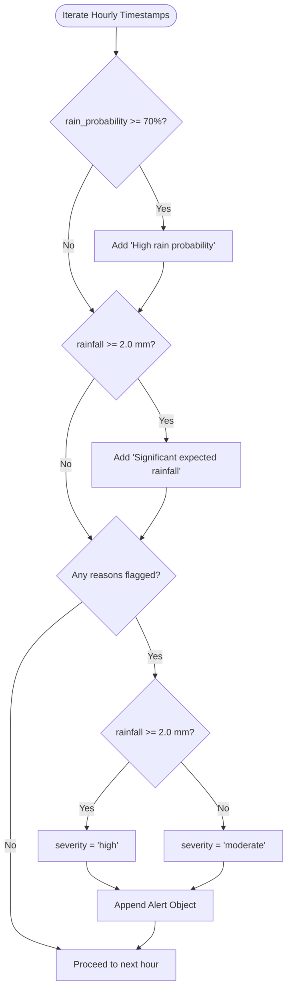

# CropSaathi Weather Service & Backend Documentation

**Status:** Technical Reference & Integration Guide  
**Project:** CropSaathi (AICON'26 Agricultural AI Decision-Support Platform)  
**Target Audience:** Engineering Team, Agronomists, API Consumers  
**Related Modules:** 
- [`CropSaathi/src/weather_service.py`](file:///Users/ayeshasaleem/Desktop/projects/AICON_AGRICULTURE_MODULE/CropSaathi/src/weather_service.py)
- [`CropSaathi/backend/main.py`](file:///Users/ayeshasaleem/Desktop/projects/AICON_AGRICULTURE_MODULE/CropSaathi/backend/main.py)
- [`CropSaathi/app.py`](file:///Users/ayeshasaleem/Desktop/projects/AICON_AGRICULTURE_MODULE/CropSaathi/app.py)

---

## 1. Overview & Purpose

In agricultural decision support, plant disease diagnosis cannot exist in a vacuum. Environmental conditions—principally rainfall, relative humidity, temperature, and wind speed—directly dictate:
1. **Spray Timing & Rainfastness:** Applying protective fungicides or treatments shortly before rainfall washes chemicals into the soil, wasting farmer investment and contaminating runoff.
2. **Pathogen Favourability:** Extended leaf wetness periods and high humidity (>80%) accelerate spore germination and disease proliferation for fungal pathogens such as Wheat Rust (*Puccinia spp.*) and Rice Leaf Blast (*Magnaporthe oryzae*).
3. **Field Operations:** Heavy rainfall and strong winds impact field accessibility, drone spraying, and equipment operation.

CropSaathi provides weather intelligence through two distinct, complementary implementations:
- **Core Python Service Module ([`weather_service.py`](file:///Users/ayeshasaleem/Desktop/projects/AICON_AGRICULTURE_MODULE/CropSaathi/src/weather_service.py)):** An in-process library designed for direct import into the Streamlit dashboard or offline decision pipelines. It normalizes WMO weather codes, formats metric values, and returns a sanitized 24-hour forecast sliced to Pakistan Standard Time (`Asia/Karachi`).
- **REST API Microservice ([`backend/main.py`](file:///Users/ayeshasaleem/Desktop/projects/AICON_AGRICULTURE_MODULE/CropSaathi/backend/main.py)):** A standalone [FastAPI](https://fastapi.tiangolo.com/) web server exposing HTTP endpoints for mobile apps, external clients, or decoupled frontend architectures. It includes a rule-based **Rain Alert Engine** categorizing precipitation risk into moderate and high agricultural severity levels.

Both components ingest hyperlocal, real-time meteorological forecasts from the open-access [Open-Meteo Weather API](https://open-meteo.com/).

---

## 2. System Architecture

The following diagram illustrates how meteorological data flows from Open-Meteo through the CropSaathi subsystems:



---

## 3. Core Python Service: `src/weather_service.py`

### 3.1 Module Details
- **Path:** [`CropSaathi/src/weather_service.py`](file:///Users/ayeshasaleem/Desktop/projects/AICON_AGRICULTURE_MODULE/CropSaathi/src/weather_service.py)
- **Primary Function:** [`get_weather(latitude, longitude)`](file:///Users/ayeshasaleem/Desktop/projects/AICON_AGRICULTURE_MODULE/CropSaathi/src/weather_service.py#L9-L128)
- **Dependencies:** `requests`, `datetime`, `zoneinfo`

### 3.2 Key Configuration & Constants
- `OPEN_METEO_URL = "https://api.open-meteo.com/v1/forecast"`
- `PAKISTAN_TZ = ZoneInfo("Asia/Karachi")`
- **Forecast Horizon:** 24 hours
- **Unit Configuration:**
  - Temperature: Celsius (`celsius`)
  - Wind Speed: Kilometres per hour (`kmh`)
  - Precipitation: Millimetres (`mm`)

### 3.3 Function Specification: `get_weather`

```python
def get_weather(latitude: float, longitude: float) -> dict
```

#### Parameters:
- `latitude` (*float*): Latitude of the farm location (e.g., `33.6844` for Islamabad, `31.5204` for Lahore).
- `longitude` (*float*): Longitude of the farm location (e.g., `73.0479` for Islamabad, `74.3587` for Lahore).

#### Internal Behavior:
1. **API Call:** Dispatches an HTTP `GET` request to Open-Meteo with a 10-second timeout.
2. **Validation:** Checks HTTP status with `response.raise_for_status()`. Raises `ValueError` if the returned payload lacks `current` or `hourly["time"]`.
3. **WMO Weather Code Interpretation:** Translates numeric World Meteorological Organization (WMO 4501) codes into plain English descriptions:
   
   | WMO Code | Description | Agricultural Significance |
   |:---|:---|:---|
   | `0` | Clear sky | Optimal for solar drying and field spraying |
   | `1, 2, 3` | Mainly clear / Partly cloudy / Overcast | Moderate evaporation; monitor cloud trends |
   | `45, 48` | Fog / Rime fog | High surface moisture; leaf wetness persists |
   | `51, 53, 55` | Light / Moderate / Dense drizzle | Fungal spore germination risk; wash-off risk |
   | `61, 63, 65` | Slight / Moderate / Heavy rain | Suspension of pesticide application; standing water |
   | `80, 81, 82` | Rain showers (Slight / Moderate / Violent) | High spray drift; rapid wash-off |
   | `95, 96, 99` | Thunderstorm (with / without hail) | Physical plant damage; lodging hazard |

4. **Timezone Filtering:** Compares ISO timestamps against the current time in `Asia/Karachi`. Discards past hours from the API batch to produce an exact 24-hour forward-looking schedule.

### 3.4 Data Structure Returned

```json
{
  "source": "Open-Meteo",
  "timezone": "Asia/Karachi",
  "units": {
    "temperature": "°C",
    "precipitation": "mm per hour",
    "wind_speed": "km/h",
    "probability": "%"
  },
  "current": {
    "time": "2026-10-10T18:00",
    "temperature_c": 24.2,
    "feels_like_c": 24.0,
    "humidity_percent": 55,
    "precipitation_mm": 0.0,
    "rain_mm": 0.0,
    "wind_speed_kmh": 7.2,
    "wind_direction_degrees": 120,
    "cloud_cover_percent": 15,
    "weather_code": 1,
    "description": "Mainly clear"
  },
  "hourly_forecast": [
    {
      "time": "2026-10-10T18:00",
      "temperature_c": 24.2,
      "humidity_percent": 55,
      "rain_probability_percent": 5,
      "precipitation_mm": 0.0,
      "wind_speed_kmh": 7.2,
      "weather_code": 1,
      "description": "Mainly clear"
    }
  ]
}
```

---

## 4. Backend Server: `backend/main.py`

### 4.1 Server Overview
- **Path:** [`CropSaathi/backend/main.py`](file:///Users/ayeshasaleem/Desktop/projects/AICON_AGRICULTURE_MODULE/CropSaathi/backend/main.py)
- **Framework:** [FastAPI](https://fastapi.tiangolo.com/)
- **App Instance:** `app = FastAPI(title="CropSaathi Weather API")`
- **Default Server Port:** `8000` (typically served via Uvicorn)

### 4.2 Endpoints

#### 1. Root / Health Probe
- **Route:** `GET /`
- **Summary:** Confirms that the weather backend microservice is alive.
- **Response (`200 OK`):**
  ```json
  {
    "message": "CropSaathi weather backend is running"
  }
  ```

#### 2. Weather & Rain Alerts
- **Route:** `GET /api/weather`
- **Summary:** Fetches current conditions, 24-hour hourly forecast, and automated rain alerts.
- **Query Parameters:**
  
  | Parameter | Type | Required | Default | Bounds | Description |
  |:---|:---|:---|:---|:---|:---|
  | `latitude` | `float` | No | `33.6844` | `-90.0` to `90.0` | Farm latitude (Default: Islamabad) |
  | `longitude` | `float` | No | `73.0479` | `-180.0` to `180.0` | Farm longitude (Default: Islamabad) |

### 4.3 Rain Alert Engine: `generate_rain_alerts(hourly)`

The function [`generate_rain_alerts`](file:///Users/ayeshasaleem/Desktop/projects/AICON_AGRICULTURE_MODULE/CropSaathi/backend/main.py#L15-L55) inspects the hourly predictions and flags actionable weather hazards based on deterministic agronomic rules:



#### Rule Definitions:
- **Condition A (High Probability):** `precipitation_probability >= 70%`  
  *Reason:* `"High rain probability"`
- **Condition B (Significant Volume):** `precipitation >= 2.0 mm`  
  *Reason:* `"Significant expected rainfall"`
- **Severity Classification:**
  - `"high"`: If anticipated rainfall meets or exceeds `2.0 mm` (regardless of probability).
  - `"moderate"`: If probability exceeds `70%` but volume is beneath `2.0 mm`.
- **Combined Message:** If both conditions are triggered, reasons are joined as `"High rain probability and Significant expected rainfall"`.

### 4.4 Example Backend Response

```json
{
  "source": "Open-Meteo",
  "location": {
    "latitude": 33.6844,
    "longitude": 73.0479
  },
  "timezone": "Asia/Karachi",
  "current": {
    "time": "2026-10-10T18:00",
    "interval": 900,
    "temperature_2m": 24.2,
    "relative_humidity_2m": 55,
    "apparent_temperature": 24.0,
    "precipitation": 0.0,
    "rain": 0.0,
    "weather_code": 1,
    "wind_speed_10m": 7.2
  },
  "hourly": {
    "time": ["2026-10-10T18:00", "2026-10-10T19:00"],
    "temperature_2m": [24.2, 23.5],
    "relative_humidity_2m": [55, 60],
    "precipitation_probability": [75, 80],
    "precipitation": [0.5, 3.2],
    "weather_code": [51, 63],
    "wind_speed_10m": [7.2, 12.1]
  },
  "rain_alerts": [
    {
      "time": "2026-10-10T18:00",
      "rain_probability_percent": 75,
      "precipitation_mm": 0.5,
      "severity": "moderate",
      "message": "High rain probability"
    },
    {
      "time": "2026-10-10T19:00",
      "rain_probability_percent": 80,
      "precipitation_mm": 3.2,
      "severity": "high",
      "message": "High rain probability and Significant expected rainfall"
    }
  ]
}
```

### 4.5 Error Handling
If Open-Meteo is unreachable, times out (>10s), returns a network failure, or serves corrupted payloads, `backend/main.py` intercepts the exception and raises a standardized HTTP 502 error:
```json
{
  "detail": "Unable to retrieve weather data. Please try again."
}
```

---

## 5. Architectural Comparison

| Dimension | `src/weather_service.py` | `backend/main.py` |
|:---|:---|:---|
| **Paradigm** | In-process Python module / utility function | Standalone REST microservice (FastAPI + ASGI) |
| **Invocation** | Direct function call `get_weather(lat, lon)` | HTTP GET requests over network `GET /api/weather` |
| **Timezone Parsing** | Slices and filters out past hours via `ZoneInfo` | Forwards Open-Meteo hourly arrays directly |
| **Alert Generation** | Returns raw hourly data with units & descriptions | Evaluates rule-based `rain_alerts` with severity |
| **Label Formatting** | Maps WMO codes to human-readable text | Passes raw numeric WMO codes |
| **Target Integration** | Streamlit UI ([`app.py`](file:///Users/ayeshasaleem/Desktop/projects/AICON_AGRICULTURE_MODULE/CropSaathi/app.py)) & pipeline orchestration | External microservices, mobile clients, decoupled architectures |

---

## 6. How to Run & Test

### 6.1 Running the Backend Server

The backend directory contains an isolated virtual environment (`CropSaathi/backend/.venv`) preconfigured with FastAPI and Uvicorn.

To start the server:

```bash
# Navigate to the backend directory
cd CropSaathi/backend

# Run using the backend virtual environment's uvicorn
./.venv/bin/uvicorn main:app --reload --host 127.0.0.1 --port 8000
```

Alternatively, from the workspace root with your active Python environment:
```bash
uvicorn CropSaathi.backend.main:app --reload --port 8000
```

### 6.2 Testing API Endpoints

Once running, verify the server status:

```bash
# 1. Health check
curl http://127.0.0.1:8000/

# 2. Weather endpoint for Islamabad (default)
curl "http://127.0.0.1:8000/api/weather"

# 3. Weather endpoint for Lahore (custom coordinates)
curl "http://127.0.0.1:8000/api/weather?latitude=31.5204&longitude=74.3587"
```

### 6.3 Interactive API Documentation
FastAPI provides automatic interactive Swagger UI and ReDoc pages:
- **Swagger UI:** [http://127.0.0.1:8000/docs](http://127.0.0.1:8000/docs)
- **ReDoc:** [http://127.0.0.1:8000/redoc](http://127.0.0.1:8000/redoc)

### 6.4 Calling `weather_service.py` in Python

To use the core weather service directly in Streamlit or tests:

```python
from src.weather_service import get_weather

# Coordinates for Faisalabad (major agricultural hub)
lat, lon = 31.4504, 73.1350
weather_data = get_weather(lat, lon)

current = weather_data["current"]
print(f"Condition: {current['description']}, Temp: {current['temperature_c']}°C")
print(f"Next 24h forecast points: {len(weather_data['hourly_forecast'])}")
```

---

## 7. Agronomic Guidelines & Safety Disclosures

In accordance with project integrity standards outlined in [`ContextualandMDFiles/AGENTS.md`](file:///Users/ayeshasaleem/Desktop/projects/AICON_AGRICULTURE_MODULE/ContextualandMDFiles/AGENTS.md):

1. **Weather is Contextual Only:** Weather conditions provide situational awareness (e.g., whether it will rain today). The system **must never** automatically infer disease existence solely from weather without a verified image classification and validated crop-disease rule.
2. **Conservative Advisory:** When rain alerts trigger (`severity == 'high'`), advisory plans should instruct farmers to hold off on foliar chemical or biological sprays until clear weather stabilizes.
3. **Transparent Uncertainty:** Weather forecasts are model estimates from Open-Meteo and can deviate from micro-climate conditions. Critical field actions should always be verified with local observations and extension workers.